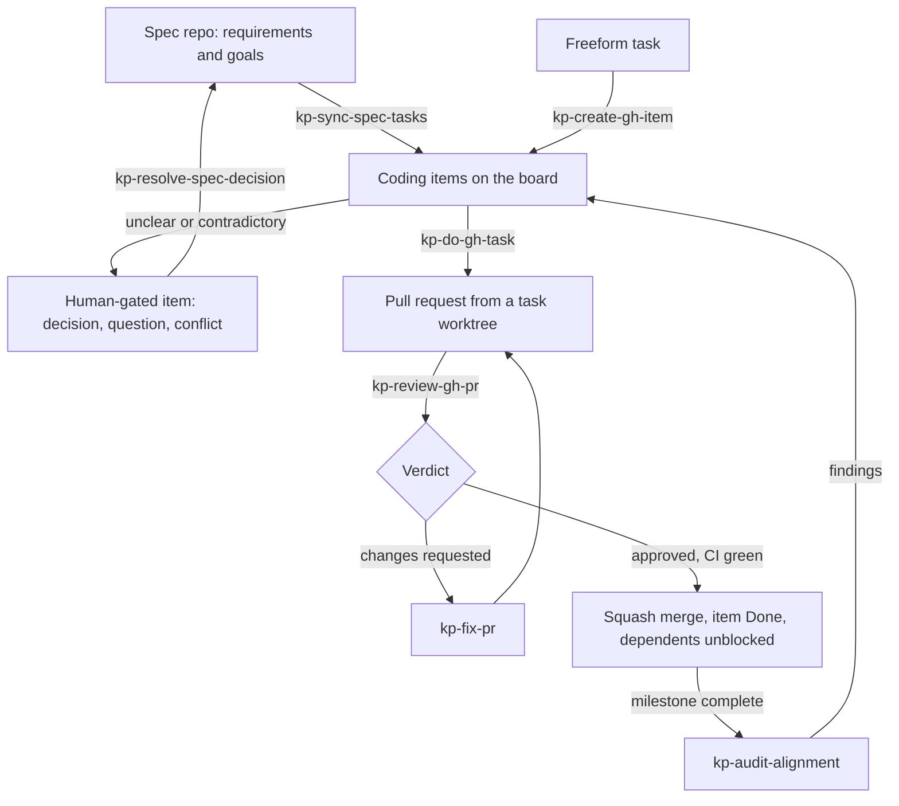

# kp-skills

A library of [Claude Code](https://claude.com/claude-code) skills that take a software
project from a written specification to merged, reviewed pull requests. The work is
tracked as GitHub issues on a project board, built by headless agents, reviewed by other
agents, and stopped at a human whenever a decision is genuinely the human's to make.

Written by Klemen Polanec.

> **Status.** This repository is a read-only snapshot of a private working repository,
> published for reference. Issues and pull requests are not accepted. The code is under
> the MIT licence; see [LICENSE](LICENSE).

## The workflow



Each box is one skill run in a fresh session. Four orchestrators chain them unattended:
`kp-do-gh-pr-loop` drives one PR through review and fix until it merges,
`kp-do-gh-task-loop` drives one item from build to merge, `kp-do-gh-pr-loop-all` walks
every open PR of a repo, and `kp-do-gh-ready-items` sweeps a whole board, milestone by
milestone, until nothing is left that an agent can do.

## Skills

| Group | Skill | What it does |
|---|---|---|
| Spec | `kp-project-spec` | Writes a build specification from a brief |
| | `kp-sync-spec-tasks` | Turns unimplemented requirements into epics and coding items |
| | `kp-resolve-spec-decision` | Folds an answered decision into the spec and the items it blocks |
| | `kp-resolve-spec-decision-auto` | Decides open decisions itself when one option is clearly best |
| | `kp-resolve-spec-research` | Researches a `type:research` item in the browser |
| Intake | `kp-create-gh-item` | Turns a freeform task into a build-ready item |
| | `kp-check` | Investigates a suspected issue read-only before anything is filed |
| | `kp-decompose-gh-task` | Splits a coarse item into independently shippable children |
| | `kp-backfill-contract` | Converts older items to the coding-item contract |
| Build and review | `kp-do-gh-task` | Builds one item in a worktree and opens the PR |
| | `kp-review-gh-pr` | Reviews a PR against the item's contract; approves and merges, or requests changes |
| | `kp-fix-pr` | Fixes the findings of a denied review |
| Orchestration | `kp-do-gh-pr-loop` | Drives one PR to merged |
| | `kp-do-gh-pr-loop-escalate` | Raises a decision when a PR's loop stops converging |
| | `kp-do-gh-pr-loop-all` | Drives every open PR of a repo to merged |
| | `kp-do-gh-task-loop` | Drives one item to merged |
| | `kp-do-gh-ready-items` | Drives every Ready item on a board to merged |
| Audit and maintenance | `kp-audit-alignment` | Audits merged code against the spec, bottom-up |
| | `kp-compact-project` | Compacts a project's notes and plans to a minimal current state |
| Standalone | `kp-init-project-repo` | Turns a folder into a version-controlled repository with hooks |
| | `kp-bootstrap-python-microservice` | Scaffolds a FastAPI service skeleton |
| | `kp-msg-me` | Sends the operator a Telegram message |
| Library | `kp-gh-lib` | Helper scripts the GitHub skills share; not a command |

## How it holds together

GitHub is the state. An item's body is its contract, marker lines in bodies carry the
dependency graph, marked comments carry review verdicts and decisions, and the board's
Status column says where each item stands. Skills are prompts; everything mechanical
(board lookups, item creation, verdict parsing, worktrees, launching and waiting on a
headless child) lives in tested scripts under `kp-gh-lib/scripts/`, described in
`kp-gh-lib/SKILL.md`. Local hooks enforce the flow, so skipping review takes intent.

More detail: [architecture](.github/docs/architecture.md),
[glossary](.github/docs/glossary.md), [threat model](.github/docs/threat-model.md), the
conventions in [CLAUDE.md](CLAUDE.md) and their
[long forms](.github/docs/conventions.md).

## Engineering notes

- **Tested offline.** More than 50 fixture suites (`<skill>/tests/<name>/run.sh`), each
  driving a script against a stub `gh` or a temporary repository; CI runs all of them
  through
  `.github/scripts/run_fixture_suites.sh`, with `shellcheck` and a frontmatter validator.
- **A costed API budget.** GitHub's GraphQL budget is 5,000 points an hour. A skill's
  whole setup costs 2 to 4 points; the commands it replaced cost 102 and 305
  (`kp-gh-lib/NOTES.md` § GitHub API budget).
- **Model choice from measurement.** On 31 merged items, sonnet items cost about 2.7×
  the tokens of opus items per item and about 3.7× per line changed, so new items are no
  longer assigned to it (`kp-gh-lib/NOTES.md` § Model-tier evidence, with its confounders).
- **A merge gate that fails closed.** A PR merges only when CI is green and an approval
  is pinned to its head commit. The gate's limits are written down next to it
  (`CLAUDE.md` § Enforcement).

## Requirements and using it yourself

A run needs Claude Code, `gh` authenticated with the `project` scope, `python3` and
`jq`. `kp-msg-me` needs Telegram credentials, and `kp-resolve-spec-research` needs the
Claude in Chrome extension.

This is a reference first and an installable product second. The skills call their
scripts by the absolute path `~/.claude/skills/…`, so the repository has to be that
directory, and they expect a GitHub Projects v2 board with the Status options the family
uses (Backlog, Ready, Blocked, In progress, In review, Done). Read the
[threat model](.github/docs/threat-model.md) before pointing them at a repository.

## Layout

One skill per top-level directory, each with a `SKILL.md` whose frontmatter `name` matches
the directory name. Skills may add `scripts/`, `templates/`, and a `NOTES.md`. Anything
that is not a skill lives under a dot-directory (`.github/`, `.claude/`), because Claude
Code treats every top-level directory as a skill candidate — except `synced/`, which the
Claude Code harness writes itself (synced Anthropic skills); it's gitignored and skipped
by `validate_skills.py` by name.

Frontmatter may also set `context: fork` (the skill runs in an isolated subagent and only
its final reply returns) and `model:` (a cheaper model while the skill runs). Which skills
use them, and when a heavy read-only phase moves into a subagent instead, follows the
token-usage rules in `CLAUDE.md`.

## Validate

```sh
python3 .github/scripts/validate_skills.py
```

Checks that every skill directory has a `SKILL.md`, that its frontmatter is a flat mapping
with a `name` matching the directory and a non-empty `description`, that `allowed-tools`
parses, and that `scripts/` and `templates/` paths cited in the body exist. CI runs the
same script on every PR, plus `shellcheck`, `python3 -m py_compile`, `ruff check`, and
`.github/scripts/run_fixture_suites.sh`, which runs every offline fixture suite
(`<skill>/tests/<name>/run.sh`).

## Working on a skill

Never edit `main` directly. Work is tracked as GitHub issues on the **KP Skills** project
board and implemented with `/kp-do-gh-task`, which builds in a worktree and opens a PR:

```sh
cd ~/.claude/skills
/kp-create-gh-item "<what needs doing>"   # files the item, adds it to the board
/kp-do-gh-task <issue-number>             # implements it, opens the PR
/kp-review-gh-pr <pr-number>              # reviews it, approves + squash-merges
git pull                                  # after merge, to make it live
```

Repo and board defaults come from `.claude/spec-sync.json`, so those skills need no flags.

That flow is enforced by hooks rather than left to discipline, because `main` here is the
directory Claude actually loads skills from. `.githooks/pre-commit` rejects a commit on
`main`, a commit made from the live directory rather than a worktree, and a branch that is
not shaped `task/<issue-number>-<slug>`. `.githooks/pre-push` rejects a direct push to
`main` and a task branch naming an issue that does not exist. `.githooks/pre-commit` and
`.githooks/commit-msg` also reject a staged change or a commit message that matches a
private denylist of terms kept outside the repository. `.claude/hooks/guard_merge.py`
rejects a merge unless CI is green and a review approval is pinned to the PR's current head
commit — so review is a gate, not a habit. `CLAUDE.md` documents each layer and its limits.

A Claude session enables the git hooks for you on start; in any other shell, once per clone:

```sh
git config core.hooksPath .githooks
```

`git commit --no-verify` / `git push --no-verify` override them when you genuinely mean to,
and nothing here binds your own shell — the point is that skipping the flow takes intent.
